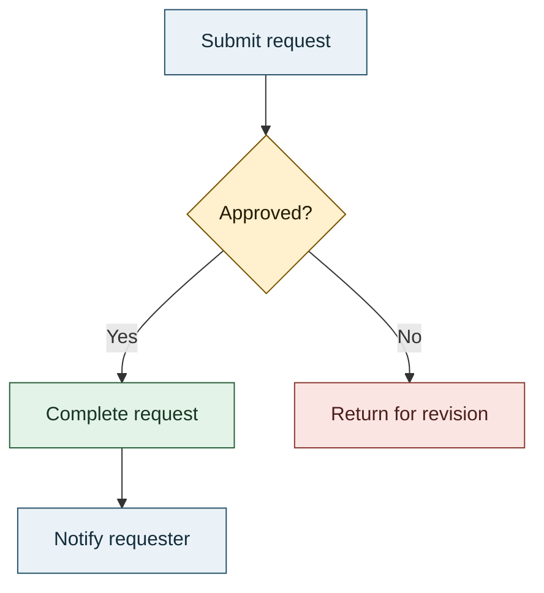

# Mermaid Diagram Instructions

## Purpose and scope

Use these instructions when creating or editing Mermaid diagrams in Markdown. Choose a diagram type that expresses the relationship or behavior, keep labels explicit, and use color to reinforce meaning rather than decorate the diagram.

For Course presentation requirements, also follow the local [Course Mermaid guidance](mermaid-course.instructions.md).

## Diagram authoring

- Use a Mermaid fenced code block; do not substitute ASCII art or manually aligned text for a diagram.
- Select the diagram type that best matches the information: `flowchart` for processes and decisions, `sequenceDiagram` for interactions over time, `stateDiagram-v2` for state transitions, `classDiagram` for type relationships, and `erDiagram` for data relationships.
- Give nodes and edges concise, specific labels. Name decision branches, including outcomes such as `Yes` and `No`.
- Keep each diagram focused on one question. Split it when the number of nodes or crossing edges makes the flow difficult to follow.
- Use consistent direction and notation within a diagram. Avoid unexplained abbreviations and decorative styling that does not communicate information.

## Semantic color requirements

**Requirement:** When color is used, assign it by semantic role and apply that meaning consistently within the diagram. Do not choose colors only for visual variety. Color is optional when it adds no clarity; leave ordinary elements neutral rather than coloring every node.

Choose roles from what the diagram communicates, not from node order or arbitrary category names:

| Semantic role       | Suggested use                                     | Example fill / stroke / text      |
| ------------------- | ------------------------------------------------- | --------------------------------- |
| Neutral step        | Ordinary actions, components, or information      | `#EAF2F8` / `#28536B` / `#152D3A` |
| Decision            | Branch points, approvals, or evaluated conditions | `#FFF0CE` / `#785400` / `#241B00` |
| Success             | Completed, accepted, or healthy outcomes          | `#E3F3E8` / `#28613A` / `#173522` |
| Warning             | Caution, retry, or attention-needed paths         | `#FCE8D5` / `#8A4B08` / `#3D260C` |
| Failure or rollback | Rejected, failed, or compensating paths           | `#FBE5E3` / `#8C3B35` / `#4B1F1B` |
| External boundary   | External services, actors, or systems             | `#E3F2F1` / `#28635E` / `#163A37` |

### Selecting and applying colors

1. Identify the diagram's important meanings first, such as normal flow, a decision, an external dependency, or a terminal outcome.
2. Use only the roles that improve comprehension. Keep the main flow neutral and reserve stronger or warmer colors for exceptional states or outcomes.
3. Reuse the same role-to-color mapping across the diagram and, when practical, across related diagrams in the same document.
4. Prefer Mermaid `classDef` and `class` declarations for reusable roles. Use per-node `style` only for a one-off distinction that has a clear meaning.
5. Set fill, stroke, and text colors explicitly when the output renderer may not preserve theme defaults. Keep text readable against the fill; aim for at least 4.5:1 contrast for normal-size text.
6. Render the diagram in its target environment and inspect it at its intended size. Adjust colors if labels, borders, or links become hard to distinguish.

Do not use color alone to communicate status or category. Pair it with explicit node or edge labels, meaningful shapes, or other visible distinctions. Ensure the diagram remains understandable in grayscale and for readers with color-vision deficiencies. Avoid rainbow palettes, low-contrast text, and assigning the same color different meanings in one diagram.

## Example

Here, labels and the decision shape identify the meaning as well as color. The normal actions share a neutral style; the decision, successful outcome, and revision path each have a distinct, consistent semantic role.

## Validation checklist

- [ ] The Mermaid block uses a diagram type suited to its purpose.
- [ ] Nodes, edges, and decision branches have clear labels.
- [ ] Any colors map consistently to semantic roles and are limited to roles that aid comprehension.
- [ ] Text and diagram elements remain distinguishable; color is not the only signal.
- [ ] The rendered diagram is readable at its intended size and in the target renderer.
- [ ] Applicable [Course Mermaid guidance](mermaid-course.instructions.md) is followed.
